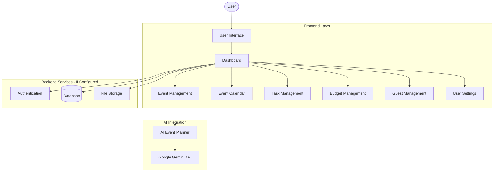
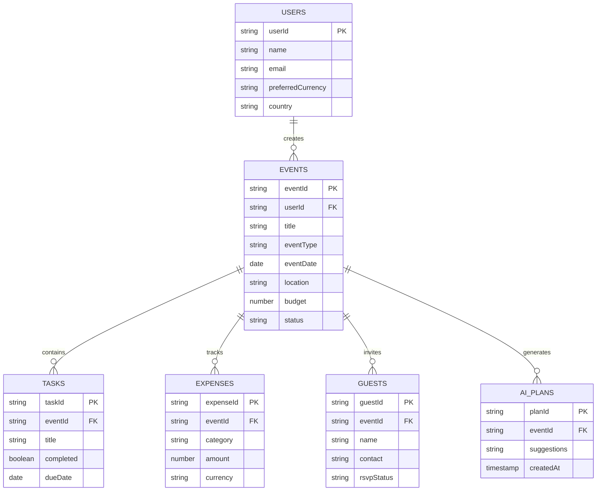

# 🌿 Moss & Moments – AI-Powered Event Planning Platform

> A unified, AI-powered event planning platform designed to simplify event organisation through intelligent planning assistance, event scheduling, budget management, guest coordination, task tracking, and personalised event experiences.


---

## 📌 Table of Contents

- [Overview](#-overview)
- [Problem Statement](#-problem-statement)
- [Solution](#-solution)
- [Key Features](#-key-features)
- [How It Works](#-how-it-works)
- [System Architecture](#-system-architecture)
- [Technology Stack](#-technology-stack)
- [Project Structure](#-project-structure)
- [Database Architecture](#-database-architecture)
- [AI Integration](#-ai-integration)
- [Installation & Setup](#-installation--setup)
- [Usage Guide](#-usage-guide)
- [Security & Data Management](#-security--data-management)
- [Testing & Verification](#-testing--verification)
- [Deployment](#-deployment)
- [Challenges & Technical Solutions](#-challenges--technical-solutions)
- [Project Status](#-project-status)
- [Future Enhancements](#-future-enhancements)
- [Contributing](#-contributing)
- [License & Contact](#-license--contact)

---

## 📖 Overview

**Moss & Moments** is an AI-powered event planning web application developed to make organising personal and social events easier, more structured, and more efficient.

Planning an event involves several interconnected activities, including selecting dates, managing budgets, coordinating guests, creating schedules, and tracking tasks. Moss & Moments brings these activities together in a centralised digital workspace.

The platform combines AI-assisted planning with practical event management tools, allowing users to organise celebrations such as:

- Weddings
- Birthday celebrations
- Anniversaries
- College events
- Social gatherings
- Private parties
- Community celebrations

Its distinctive woodland-inspired visual identity, intuitive navigation, and customisable themes aim to provide a welcoming and organised planning experience.

---

## 🎯 Problem Statement

Traditional event planning often involves managing information across multiple applications, documents, spreadsheets, and communication platforms.

The major challenges include:

1. **Fragmented Event Information:** Event details, schedules, guest lists, and expenses are often maintained separately.
2. **Time-Consuming Planning:** Creating event schedules, checklists, and ideas manually requires considerable effort.
3. **Budget Management Difficulties:** Tracking estimated costs, actual expenses, and remaining budgets can become complicated.
4. **Guest Coordination:** Maintaining guest information and RSVP responses across different platforms creates unnecessary complexity.
5. **Missed Deadlines:** Without organised task tracking and reminders, important preparation activities can be overlooked.
6. **Lack of Personalisation:** Generic event templates may not suit different event types, preferences, and budgets.

---

## 💡 Solution

**Moss & Moments** addresses these challenges through a unified event management platform offering:

- **AI-Assisted Planning:** Generate personalised event ideas, suggestions, schedules, and planning assistance.
- **Centralised Event Management:** Maintain event details and related information in one workspace.
- **Interactive Event Calendar:** Visualise upcoming events and important dates through a calendar interface.
- **Task Organisation:** Create checklists and monitor event preparation progress.
- **Budget Tracking:** Organise estimated budgets and actual expenses.
- **Guest Coordination:** Maintain guest lists and track RSVP information.
- **Flexible Preferences:** Configure preferred country, currency, and visual themes.

---

## 🔥 Key Features

### 🔐 1. Profile & Account Management

- Profile interface for managing user information and preferences.
- Account menu for accessing profile-related settings.
- Profile selection interface, where supported by the configured account system.
- Persistent user preferences.

### 🤖 2. AI-Powered Event Planner

- AI-assisted event planning using Google Gemini.
- Personalised suggestions based on event type, budget, date, and preferences.
- Event theme and decoration ideas.
- Suggested planning checklists and schedules.
- AI-generated recommendations to reduce manual planning effort.

### 📅 3. Event Management & Interactive Calendar

- Create and manage multiple events.
- Store essential information such as event name, type, date, time, location, and description.
- Monthly calendar navigation.
- Visual event markers on scheduled dates.
- Date selection to view associated events.
- Upcoming event overview.

### ✅ 4. Task & Checklist Management

- Create event-specific tasks.
- Organise preparation activities.
- Track completed and pending tasks.
- Monitor event preparation progress.
- Maintain structured checklists.

### 💰 5. Budget & Expense Management

- Set estimated event budgets.
- Record individual expenses.
- Organise expenses into categories.
- Monitor total spending and remaining budget.
- Display budget summaries.
- Support preferred currency formatting.

### 👥 6. Guest Management & RSVP

- Maintain event guest lists.
- Store guest contact information.
- Track invitation and RSVP status.
- Organise guest information by event.
- Monitor confirmed and pending responses.

### 🌍 7. Country & Currency Preferences

- Select preferred country and currency.
- Support commonly used international currencies.
- Display currency symbols and locale-specific formatting.
- Maintain user currency preferences.
- Support exchange-rate-based conversion where configured.

### 🎨 8. Theme Customisation

- Light and dark appearance modes.
- Consistent theme application across the interface.
- Persistent theme preference.
- Woodland-inspired visual identity.
- Responsive interface for different screen sizes.

---

## ⚙️ How It Works

The general application workflow:

```text
             [ User ]
                |
                ▼
       [ Open Application ]
                |
                ▼
        [ Dashboard ]
                |
        ┌───────┼────────┐
        ▼       ▼        ▼
     [Events] [AI Plan] [Settings]
        |       |        |
        ▼       ▼        ▼
    Event     Generate  Country &
    Details   Suggestions Currency
        |
        ▼
   ┌────┼──────────┐
   ▼    ▼          ▼
[Tasks][Budget] [Guests]
   |    |          |
   ▼    ▼          ▼
Progress Expense  RSVP
Tracking Tracking Management
   |    |          |
   └────┼──────────┘
        |
        ▼
 [ Organised Event ]
```

---

## 🏗 System Architecture

The application follows a modular web application architecture.



---

## 🛠 Technology Stack

| Category | Technology | Purpose |
|---|---|---|
| Frontend | React / JavaScript | Interactive user interface |
| Markup | HTML5 | Application structure |
| Styling | CSS3 | Responsive layouts and theme design |
| AI Integration | Google Gemini | AI-assisted event planning |
| Backend | Existing configured backend | Application logic and data services |
| Database | Existing configured database | Persistent event and user data |
| Development | Google AI Studio | AI-assisted application development |
| Version Control | Git and GitHub | Source code management |
| Deployment | Google Cloud Run | Application hosting |

*Note: Confirm the actual framework, database, backend and deployment configuration in the final source code before treating this table as a complete record of implemented integrations.*

---

## 📂 Project Structure

The following represents a suggested logical organisation. Adapt the directory names to match the actual repository.

```text
moss-and-moments/
│
├── public/
│   └── assets/
│       ├── images/
│       └── icons/
│
├── src/
│   ├── components/
│   │   ├── Navbar
│   │   ├── Sidebar
│   │   ├── EventCard
│   │   ├── Calendar
│   │   ├── TaskList
│   │   ├── BudgetCard
│   │   └── GuestList
│   │
│   ├── pages/
│   │   ├── Landing
│   │   ├── Dashboard
│   │   ├── Events
│   │   ├── EventDetails
│   │   ├── AIPlanner
│   │   └── Settings
│   │
│   ├── services/
│   │   ├── aiService
│   │   ├── eventService
│   │   └── currencyService
│   │
│   ├── hooks/
│   ├── context/
│   ├── styles/
│   ├── utils/
│   ├── App
│   └── main
│
├── index.html
├── package.json
├── README.md
└── .gitignore
```

---

## 🗄 Database Architecture

The following is a conceptual data model for the platform. The actual schema depends on the configured backend.

### Main Data Entities

| Entity | Description |
|---|---|
| Users | User profile and preferences |
| Events | Event details and schedules |
| Tasks | Event preparation tasks |
| Expenses | Budget and expense records |
| Guests | Guest details and RSVP information |
| AI Plans | Generated event planning suggestions |

### Entity Relationship Diagram



---

## 🤖 AI Integration

Moss & Moments uses Google Gemini as the intended AI assistance layer.

### AI Event Planning Workflow

1. The user enters event details and planning preferences.
2. The application prepares a structured request.
3. The request is sent to the configured AI service.
4. Gemini processes the information.
5. The generated suggestions are returned to the application.
6. The user can review and use the planning recommendations.

### Example Planning Inputs

- Event type
- Event date
- Number of guests
- Estimated budget
- Location
- Theme preferences
- Special requirements

### Expected AI Outputs

- Event planning suggestions.
- Decoration and theme ideas.
- Budget allocation recommendations.
- Task checklists.
- Suggested event timelines.

**Security consideration:** AI credentials should be handled through secure server-side configuration rather than exposed in frontend source code.

---

## 📦 Installation & Setup

### Prerequisites

- Node.js
- npm
- Git
- A modern web browser

### Step 1: Clone Repository

```bash
git clone https://github.com/YOUR_USERNAME/moss-and-moments.git
cd moss-and-moments
```

### Step 2: Install Dependencies

```bash
npm install
```

### Step 3: Run the Application

```bash
npm run dev
```

Open the local development URL displayed in the terminal.

*Note: These commands assume the repository contains a compatible Node.js development setup. Refer to the project's package scripts if the commands differ.*

---

## 🖥 Usage Guide

1. **Access the Platform:** Open Moss & Moments through the deployed application URL.
2. **Explore the Dashboard:** View event summaries and available planning tools.
3. **Create an Event:** Enter the event name, type, date, location and other details.
4. **Use AI Assistance:** Submit event preferences to generate planning suggestions.
5. **Manage Tasks:** Add preparation activities and track completion.
6. **Track Budget:** Record expenses and review budget summaries.
7. **Manage Guests:** Add guests and update their RSVP information.
8. **View Calendar:** Navigate between months and select dates to view scheduled events.
9. **Customise Settings:** Choose the preferred appearance, country and currency.

---

## 🔒 Security & Data Management

The application should follow these security principles:

- Protect user-specific event information.
- Restrict access to private data through the configured authentication and authorisation system.
- Avoid exposing private API credentials in frontend code.
- Validate user inputs before processing.
- Handle API errors and unavailable services gracefully.
- Avoid storing sensitive information unnecessarily.

The actual authentication, database access rules and security configuration depend on the deployed backend.

---

## ✅ Testing & Verification

The following checklist can be used to validate the application.

| Module | Test Scenario | Expected Result |
|---|---|---|
| Dashboard | Open application dashboard | Dashboard loads correctly |
| Events | Create a new event | Event details are saved |
| Events | Edit event information | Updated details are displayed |
| Calendar | Navigate between months | Correct calendar month appears |
| Calendar | Select a date with events | Associated events are displayed |
| AI Planner | Submit event preferences | Planning suggestions are returned |
| Tasks | Mark a task complete | Task status updates |
| Budget | Add an expense | Budget summary recalculates |
| Guests | Update RSVP status | Guest status is updated |
| Currency | Change preferred currency | Currency formatting updates |
| Theme | Switch light and dark modes | Application appearance changes |
| Persistence | Refresh application | Saved information remains available where persistence is configured |

*Testing status should be updated after executing these checks. Do not mark untested scenarios as verified.*

---

## 🚀 Deployment

### Google AI Studio / Google Cloud Run

The application can be deployed through the available Google AI Studio publishing workflow.

General deployment process:

1. Open the project in Google AI Studio.
2. Review the application and verify its functionality.
3. Select the publishing or deployment option.
4. Configure the required Google Cloud project settings.
5. Complete the deployment.
6. Obtain the public application URL.
7. Test the deployed application in a separate browser session.

### GitHub Repository

The source code is maintained in GitHub for version control and project accessibility.

**Repository:** https://github.com/YOUR_USERNAME/moss-and-moments

### Live Application

**Live Demo:** YOUR_DEPLOYED_APP_URL

### Project Demonstration

**Walkthrough Video:** YOUR_DEMO_VIDEO_URL

---

## 🛠 Challenges & Technical Considerations

### 1. Managing Multiple Event Components

- **Challenge:** Events involve multiple related components, including guests, expenses and tasks.
- **Approach:** Organise these features into separate modules associated with individual events.

### 2. AI-Generated Planning Suggestions

- **Challenge:** Event requirements differ depending on the user's preferences and budget.
- **Approach:** Structure AI requests using event-specific information to generate relevant recommendations.

### 3. Currency Handling

- **Challenge:** Users may plan events in different countries and currencies.
- **Approach:** Separate stored transaction currency from preferred display currency and use reliable exchange-rate information for conversions.

### 4. Theme Consistency

- **Challenge:** Maintaining readable and consistent components across light and dark modes.
- **Approach:** Use shared design tokens and theme variables throughout the application.

### 5. Calendar Synchronisation

- **Challenge:** Displaying events accurately across different dates and time zones.
- **Approach:** Use consistent date handling and derive calendar markers from saved event records.

---

## 🚥 Project Status

**Current Version:** `v1.0.0 (MVP)`

### Core Modules

- [x] Landing page and application interface
- [x] Dashboard interface
- [x] Event planning interface
- [x] AI-assisted planning interface
- [x] Task management interface
- [x] Budget management interface
- [x] Guest management interface
- [x] Theme customisation interface
- [x] Calendar interface
- [x] Country and currency preferences interface

*The checklist indicates intended MVP modules. Confirm that each feature is functional and integrated before marking it as fully implemented.*

### Future Development

- [ ] Collaborative event planning.
- [ ] Vendor discovery and booking.
- [ ] Automated email and notification reminders.
- [ ] AI-powered moodboard generation.
- [ ] PDF event plan exports.
- [ ] Advanced event analytics.
- [ ] Shared planning workspaces.

---

## 🔮 Future Enhancements

Potential improvements include:

- Real-time collaboration between event organisers.
- Vendor marketplace and service comparisons.
- Automated guest invitation management.
- Calendar synchronisation with external calendar services.
- AI-generated event moodboards.
- Downloadable budget and event reports.
- Personalised event recommendations.

---

## 🤝 Contributing

Contributions and suggestions are welcome.

To contribute:

1. Fork the repository.
2. Create a feature branch.
3. Implement your changes.
4. Commit your updates.
5. Push the branch to your fork.
6. Submit a Pull Request.

---

## 📄 License & Contact

**License:** MIT License, if the repository includes the corresponding MIT license file.

**Project:** Moss & Moments  
**Category:** AI-Powered Event Management  
**Repository:** https://github.com/bhumika-diaries/moss-and-moments.git

---

<p align="center">
  <strong>🌿 Moss & Moments</strong><br>
  <em>Little details. Beautifully planned moments.</em>
</p>
